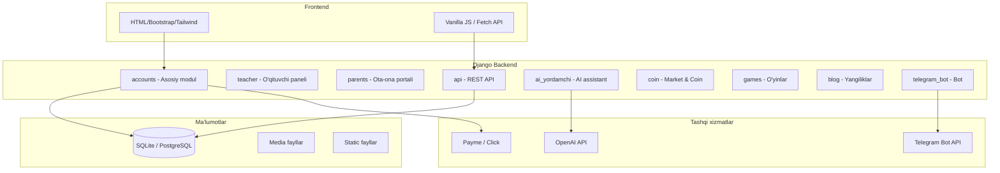

<p align="center">
  
</p>

<h1 align="center">🚀 IT Creative Zomin — Learning Management System</h1>

<p align="center">
  <strong>Özbekiston IT ta'lim markazlari uçun töliq funksional ta'lim boşqaruv tizimi</strong>
</p>

<p align="center">
  <a href="https://www.python.org/downloads/"></a>
  <a href="https://www.djangoproject.com/"></a>
  <a href="https://www.django-rest-framework.org/"></a>
  <a href="https://openai.com/"></a>
  <a href="https://core.telegram.org/bots/api"></a>
  <a href="https://opensource.org/licenses/MIT"></a>
</p>

<p align="center">
  <a href="https://itc-academy.uz">🌐 Sayt</a> •
  <a href="#-örnatish">⚙️ Örnatiş</a> •
  <a href="#-api-hujjatlari">📡 API</a> •
  <a href="#-xavfsizlik">🔐 Xavfsizlik</a> •
  <a href="#-deploy-qilish">🚀 Deploy</a>
</p>

---

## 📋 Mundarija

- [Loyiha haqida](#-loyiha-haqida)
- [Texnologiyalar](#-texnologiyalar)
- [Arxitektura](#-arxitektura)
- [Foydalanuvchi rollari](#-foydalanuvchi-rollari)
- [Ilovalar (Apps)](#-ilovalar-apps)
- [Örnatish](#-örnatish)
- [Muhit özgaruvçilari](#-muhit-özgaruvchilari)
- [API hujjatlari](#-api-hujjatlari)
- [Xavfsizlik](#-xavfsizlik)
- [Telegram bot](#-telegram-bot)
- [Deploy qiliş](#-deploy-qilish)
- [Loyiha tuzilişi](#-loyiha-tuzilishi)
- [Muallif](#-muallif)

---

## 📖 Loyiha haqida

**IT Creative Zomin LMS** — bu IT ta'lim markazlari uçun yaratilgan töliq funksional ta'lim boşqaruv tizimi. Tizim öquvçilar, öqituvçilar, adminlar va ota-onalar uçun alohida dashboardlar bilan ta'minlangan.

### ✨ Asosiy imkoniyatlar

| Yönaliş | Imkoniyatlar |
|-----------|-------------|
| 📚 **Ta'lim** | Kurslar, bölimlar, darslar (video, uyga vazifa, test, luğat, speaking) |
| 🤖 **Sun'iy intellekt** | OpenAI asosidagi AI yordamçi, uy vazifalarini AI bilan tekşiriş |
| 🪙 **Coin iqtisodiyoti** | Coin qölga kiritiş, dökon, P2P transfer, faollik mukofotlari |
| 🎮 **Öyinlar** | Typing challenge, söz öyini, shaxmat/shashka, musobaqalar |
| 📝 **Blog** | Yangiliklar, maqolalar, likes & comments |
| 🤖 **Telegram bot** | OTP login, bildirişnomalar, AI çat, ommaviy xabarlar |
| 👨‍👩‍👧 **Ota-ona portali** | Farzand progressini kuzatiş, tölovlar, öqituvçi bilan aloqa |
| 💳 **Tölov tizimi** | Payme & Click integratsiya, balans, avtomatik çegirmalar |
| 📊 **Sertifikatlar** | Avtomatik PDF sertifikat generatsiya, CERT-ID bilan tekşiriş |
| 💬 **Çat tizimi** | Guruh çat, şaxsiy xabarlar, reaktsiyalar, reply, pin |
| 📋 **Sörovnomalar** | Dinamik sörovnoma yaratiş (8 xil savol turi) |
| 📖 **Kutubxona** | Kitob ijarasi, eslatmalar, qaytariş kuzatuvi |
| 🏆 **Gamifikatsiya** | XP/level tizimi, streak, yutuqlar, reyting |

---

## 🛠 Texnologiyalar

### Backend

| Texnologiya | Versiya | Vazifasi |
|-------------|---------|----------|
| Python | 3.10+ | Asosiy til |
| Django | 5.1 | Web framework |
| Django REST Framework | 3.15.2 | REST API |
| Django Jazzmin | 3.0.2 | Admin panel UI (Cyborg tema) |
| WhiteNoise | 6.11.0 | Statik fayllar |
| Pillow | 12.1.1 | Rasm işlov beriş |
| ReportLab | 4.4.10 | PDF sertifikat generatsiya |
| OpenAI SDK | 2.21.0 | AI yordamçi |
| openpyxl | 3.1.5 | Excel eksport |
| psycopg2-binary | — | PostgreSQL driver |
| argon2-cffi | 23.1+ | Kuçli parol haşlaş |
| python-dotenv | 1.0.1 | Muhit özgaruvçilari |
| requests | 2.32.5 | HTTP sörovlar (Telegram API) |

### Frontend

| Texnologiya | Vazifasi |
|-------------|----------|
| HTML5 + Bootstrap 5 | Asosiy UI |
| Tailwind CSS (CDN) | Landing sahifalar |
| Vanilla JS + Fetch API | Dinamik funksionallik |
| Quill.js | Rich text editor |

### Ma'lumotlar bazasi

| Muhit | Texnologiya |
|-------|------------|
| Development | SQLite |
| Production | PostgreSQL |

---

## 🏗 Arxitektura



---

## 👥 Foydalanuvçi rollari

### 🔴 Admin
- Töliq tizim boşqaruvi
- Öquvchi/öqituvchi qöşiş va boşqariş
- Kurslar, darslar, testlar yaratiş
- Tölovlarni boşqariş va monitoring
- Tizim statistikasi va hisobotlar (PDF/Excel)
- Ommaviy xabar yuboriş (Telegram + tizim içida)
- Maintenance mode boşqaruvi
- Xavfsizlik hodisalarini kuzatiş

### 🟡 Yordamçi admin
- Granular permission tizimi (AssistantRole modeli)
- Admin tomonidan belgilangan vakolatlar doirasida işlaş
- Harakatlar audit log bilan kuzatiladi

### 🟢 Öqituvçi
- Öz kurslaridagi darslarni boşqariş
- Uyga vazifalarni tekşiriş va baholaş
- Öquvçi progressini kuzatiş
- Maoş va davomat köriş
- Sertifikatlarni boşqariş
- Öquvçilar bilan çat

### 🔵 Öquvçi
- Kurslarga yoziliş va darslarni örganiş
- Video darslar, testlar, uyga vazifalar
- AI yordamçidan foydalaniş
- Coin yiğiş va dökonda sarflaş
- Öyinlar va musobaqalarda qatnaşiş
- Sertifikat oliş
- Blog yoziş va boşqalar bilan muloqot

### 🟣 Ota-ona
- Alohida portal (Django User emas, mustaqil model)
- Farzand progressini real-time kuzatiş
- Test natijalari va baholaş
- Tölov tarixi
- Öqituvçi bilan xabar almaşiş
- Kitob ijarasi köriş

---

## 📦 Ilovalar (Apps)

### 1. `accounts` — Asosiy modul

> Tizimning eng katta va asosiy moduli. 50+ model, 600KB+ views.

**Asosiy modellar:**

| Model | Vazifasi |
|-------|----------|
| `CustomUser` | Foydalanuvçilar (admin, teacher, student, assistant_admin) |
| `Profession` | Kurslar va kasblar (pullik/bepul, sertifikatli, AI tekşiruv) |
| `Section` | Kurs bölimlari (tartiblanuvçi) |
| `Lesson` | Darslar (video, homework, test, dictionary, speaking) |
| `VideoLesson` | Video darslar (YouTube/Vimeo) |
| `Homework` / `HomeworkSubmission` | Uyga vazifalar va topşiriqlar |
| `Test` / `TestQuestion` / `TestResult` | Test tizimi (lesson, midterm, practice, final) |
| `Certificate` | Sertifikatlar (CERT-YYYYMMDD-XXXX format) |
| `PaymentStatus` / `PaymentRecord` | Tölov kuzatuvi |
| `StudentBalance` | Balans tizimi (auto-deduction) |
| `Message` | Tizim içki bildiriş nomalari (12 tur) |
| `UserDevice` / `UserSession` | Qurilma va sessiya boşqaruvi |
| `GroupChatMessage` / `DirectMessage` | Çat tizimi |
| `SurveyForm` / `SurveyQuestion` | Sörovnoma tizimi |
| `PaymeTransaction` / `ClickTransaction` | Tölov gateway integratsiya |
| `SecurityEvent` | Xavfsizlik hodisalari log |
| `Book` / `BookRental` | Kutubxona tizimi |
| `Parent` / `ParentMessage` | Ota-ona modeli va xabarlar |
| `AssistantRole` / `AssistantActionLog` | Yordamçi admin roli va audit |

---

### 2. `teacher` — Öqituvçi paneli

| Model | Vazifasi |
|-------|----------|
| `TeacherCertificate` | Öqituvçi sertifikatlari |
| `TeacherSalary` | Maoş (oylik, KPI, bonus, jarima, bayram) |
| `TeacherAttendance` | Davomat (keldi, kelmadi, keç qoldi, kasal, ta'til) |

---

### 3. `parents` — Ota-ona portali

Alohida login tizimi bilan farzandlar progressini kuzatiş, tölov tarixi, öqituvçi bilan aloqa.

---

### 4. `api` — REST API (DRF)

```
/api/v1/token/              — Autentifikatsiya token olish
/api/v1/status/             — API holati
/api/v1/profile/            — Profil ma'lumotlari
/api/v1/profile/complete/   — Profil to'ldirish
/api/v1/courses/            — Kurslar CRUD
/api/v1/students/           — O'quvchilar ro'yxati
/api/v1/coin/               — Coin operatsiyalari
/api/v1/reyting/            — Reyting/leaderboard
```

**Konfiguratsiya:** Token + Session auth, PageNumberPagination (20/sahifa), JSON renderer, coin_transfer throttle (10/min).

---

### 5. `ai_yordamchi` — AI yordamçi

| Model | Vazifasi |
|-------|----------|
| `ChatSession` | Foydalanuvçi AI çat sessiyalari |
| `ChatMessage` | Xabarlar (user/assistant), rasm va fayl qöllab-quvvatlash |

OpenAI GPT asosida kurs mavzulari böyiça savol-javob. Har bir sörov uçun coin sarflanadi.

---

### 6. `coin` — Coin iqtisodiyoti va dökon

| Model | Vazifasi |
|-------|----------|
| `Product` | Dökon mahsulotlari (nom, narx, zaxira) |
| `ProductLike` / `ProductComment` | Like va izohlar |
| `ProductPurchase` | Xarid tarixi (pending/delivered/cancelled) |
| `CoinTransaction` | Tranzaksiya logi (add/remove/purchase) |
| `CoinTransfer` | P2P transfer (10% komissiya, tasdiqlaş kodi) |
| `ActivityLog` | Faollik kuzatuvi (17 xil harakat turi) |

---

### 7. `games` — Öyinlar va musobaqalar

| Model | Vazifasi |
|-------|----------|
| `Game` | Öyin turlari (typing, quiz, word_builder, external) |
| `Prompt` | Typing challenge matnlari (qiyinlik darajali) |
| `Competition` | Musobaqalar (coin mukofotlar: 1/2/3 örin) |
| `GameAttempt` | Typing natijalar (WPM, aniqlik, ball) |
| `BoardMatch` | Multiplayer öyinlar (shaxmat/shashka, coin tikiş) |
| `WordRound` / `WordGameAttempt` | Söz öyini |
| `GameProgress` / `UserAchievement` | XP/level/yutuqlar tizimi |

> 🔒 **Xavfsizlik:** HMAC asosida natijalar tekşiruvi (cheat prevention).

---

### 8. `blog` — Yangiliklar va maqolalar

| Model | Vazifasi |
|-------|----------|
| `Post` | Maqolalar (news, tutorial, tips, announcement) |
| `PostLike` / `PostComment` | Like va izohlar (coin mukofotli) |
| `CommentLike` | Izoh likelari |

---

### 9. `telegram_bot` — Telegram bot

| Model | Vazifasi |
|-------|----------|
| `TelegramLoginCode` | OTP login kodlari (6 raqamli, 5 daqiqa) |
| `TelegramLinkToken` | Akkaunt boğlaş tokenlari |
| `TelegramMessageLog` | Kiruvçi xabarlar logi |
| `ContactMessage` | Saytdan aloqa xabarlari |
| `TelegramBroadcastMessage` | Ommaviy xabar yuboriş |
| `TelegramChatState` | Foydalanuvçi holati (AI çat, contact mode) |

---

## ⚙️ Örnatiş

### Talablar

- Python 3.10+
- pip
- Git
- SQLite (development) yoki PostgreSQL (production)

### 1. Repozitoriyani klonlaş

```bash
git clone https://github.com/Xusanbek0039/learning-managment-sistem-django.git
cd learning-managment-sistem-django
```

### 2. Virtual muhit yaratiş

```bash
python -m venv venv

# Windows
venv\Scripts\activate

# Linux / macOS
source venv/bin/activate
```

### 3. Kutubxonalarni örnatiş

```bash
pip install -r requirements.txt
```

### 4. Muhit özgaruvçilarini sozlaş

`.env` faylini yarating:

```bash
cp .env.example .env
```

`.env` faylini töldiring (pastdagi [Muhit özgaruvçilari](#-muhit-özgaruvchilari) bölimiga qarang).

### 5. Ma'lumotlar bazasini migratsiya qiliş

```bash
python manage.py makemigrations
python manage.py migrate
```

### 6. Superuser yaratiş

```bash
python manage.py createsuperuser
```

### 7. Statik fayllarni yiğiş

```bash
python manage.py collectstatic --noinput
```

### 8. Serverni işga tuşiriş

```bash
python manage.py runserver
```

Brauzerda oçing: [http://127.0.0.1:8000](http://127.0.0.1:8000)

Admin panel: [http://127.0.0.1:8000/admin/](http://127.0.0.1:8000/admin/)

---

## 🔑 Muhit özgaruvçilari

`.env` faylida quyidagi özgaruvçilarni sozlang:

```env
# ═══════════════════════════════════════
# 🔐 ASOSIY SOZLAMALAR
# ═══════════════════════════════════════
DJANGO_SECRET_KEY=your-super-secret-key-here
SECRET_KEY=your-super-secret-key-here
DEBUG=True
ALLOWED_HOSTS=localhost,127.0.0.1
CSRF_TRUSTED_ORIGINS=http://localhost:8000

# ═══════════════════════════════════════
# 🗄 MA'LUMOTLAR BAZASI (Production)
# ═══════════════════════════════════════
DB_ENGINE=django.db.backends.postgresql
DB_NAME=lms_database
DB_USER=db_user
DB_PASSWORD=db_password
DB_HOST=localhost
DB_PORT=5432

# ═══════════════════════════════════════
# 🤖 OPENAI (AI yordamchi uchun)
# ═══════════════════════════════════════
OPENAI_API_KEY=sk-proj-your-openai-api-key

# ═══════════════════════════════════════
# 📱 TELEGRAM BOT
# ═══════════════════════════════════════
TELEGRAM_BOT_TOKEN=your-bot-token
TELEGRAM_BOT_USERNAME=your_bot_username
TELEGRAM_GROUP_CHAT_ID=-100xxxxxxxxxx
TELEGRAM_USE_PREMIUM_EMOJI=true
TELEGRAM_USE_STICKERS=true
SITE_URL=https://your-domain.uz

# ═══════════════════════════════════════
# 🛡 XAVFSIZLIK
# ═══════════════════════════════════════
LOGIN_MAX_ATTEMPTS=5
LOGIN_LOCKOUT_DURATION=15
GAME_HMAC_SECRET=your-hmac-secret

# ═══════════════════════════════════════
# 🔑 RECAPTCHA
# ═══════════════════════════════════════
RECAPTCHA_SITE_KEY=your-recaptcha-site-key
RECAPTCHA_SECRET_KEY=your-recaptcha-secret-key
```

---

## 📡 API hujjatlari

### Autentifikatsiya

API **Token** va **Session** autentifikatsiyasini qöllab-quvvatlaydi.

**Token oliş:**
```http
POST /api/v1/token/
Content-Type: application/json

{
    "username": "student_user",
    "password": "your_password"
}
```

**Javob:**
```json
{
    "token": "abc123def456..."
}
```

**Tokenni işlatiş:**
```http
GET /api/v1/profile/
Authorization: Token abc123def456...
```

### Asosiy endpointlar

| Metod | Endpoint | Tavsif |
|-------|----------|--------|
| `POST` | `/api/v1/token/` | Auth token oliş |
| `GET` | `/api/v1/status/` | API holati |
| `GET` | `/api/v1/profile/` | Profil ma'lumotlari |
| `PUT` | `/api/v1/profile/complete/` | Profil töldiriş |
| `GET` | `/api/v1/courses/` | Kurslar röyxati |
| `GET` | `/api/v1/students/` | Öquvçilar (admin) |
| `GET/POST` | `/api/v1/coin/` | Coin operatsiyalari |
| `GET` | `/api/v1/reyting/` | Reyting jadvali |

### Öyin API (taşqi öyinlar uçun)

| Metod | Endpoint | Tavsif |
|-------|----------|--------|
| `POST` | `/api/v1/external-game/sso-verify/` | SSO tekşiriş |
| `POST` | `/api/v1/external-game/result/` | Natija yuboriş |
| `POST` | `/api/v1/external-game/multiplayer/find/` | Raqib topiş |
| `GET` | `/api/v1/external-game/multiplayer/state/` | Öyin holati |
| `POST` | `/api/v1/external-game/multiplayer/move/` | Yuriş |
| `GET` | `/api/v1/external-game/gamification/profile/` | Öyinçi profili |
| `GET` | `/api/v1/external-game/gamification/leaderboard/` | Liderlar jadvali |

### Paginatsiya

Barça röyxat endpointlari `PageNumberPagination` işlatadi (har sahifada 20 ta element):

```json
{
    "count": 150,
    "next": "http://example.com/api/v1/courses/?page=2",
    "previous": null,
    "results": [...]
}
```

### Rate Limiting

| Endpoint | Limit |
|----------|-------|
| Coin transfer | 10 sörov/daqiqa |

---

## 🔐 Xavfsizlik

### Middleware zanjiri (tartib böyiça)

```
1.  SecurityMiddleware              — Django o'rnatilgan xavfsizlik
2.  RequestSizeLimitMiddleware      — >20MB so'rovlarni bloklash
3.  GlobalRateLimitMiddleware       — DDoS / brute-force himoya
4.  WhiteNoiseMiddleware            — Statik fayllar
5.  SessionMiddleware               — Session boshqaruvi
6.  CommonMiddleware                — URL normalizatsiya
7.  CsrfViewMiddleware              — CSRF himoya
8.  AuthenticationMiddleware        — Autentifikatsiya
9.  MessageMiddleware               — Flash xabarlar
10. XFrameOptionsMiddleware         — Clickjacking himoya
11. SecurityHeadersMiddleware       — CSP, HSTS headerlari
12. MaintenanceMiddleware           — Texnik xizmat rejimi
13. BlockedUserMiddleware           — Bloklangan foydalanuvchilar
14. SessionTimeoutMiddleware        — 2 soatlik session timeout
15. DeviceLimitMiddleware           — Qurilma soni cheklovi
16. ProfileCompletionMiddleware     — Profil to'ldirish majburiyati
17. SectionBlockMiddleware          — Bo'limlar blokirovkasi
18. UpdateLastActivityMiddleware    — Faollik kuzatuvi
19. PaymentCheckMiddleware          — To'lov tekshiruvi
20. BirthdayCheckMiddleware         — Tug'ilgan kun tabrik
21. PremiumExpiryMiddleware         — Premium muddati tekshiruvi
```

### Xavfsizlik çoralari

| Himoya | Tavsif |
|--------|--------|
| **Parol haşlaş** | PBKDF2 (default) + Argon2 (agar örnatilgan bölsa) |
| **HTTPS** | HSTS 1 yil (production), SSL redirect, secure cookies |
| **CSP** | Content Security Policy — XSS hujumlardan himoya |
| **CSRF** | SameSite=Lax, HttpOnly cookies |
| **Session** | DB-backed, custom cookie (`itc_sid`), 2 soat muddatli |
| **Login himoya** | 5 ta uriniş, 15 daqiqa blokirovka |
| **Fayl yuklaş** | Max 10MB (fayl), Max 20MB (umumiy) |
| **Öyin xavfsizligi** | HMAC-based natija tekşiruvi |
| **Logging** | Rotating file handler (5MB × 10 fayl) |
| **Qurilma boşqaruvi** | Qurilma limiti, işonçli qurilma tizimi |

### Xavfsizlik hodisalari

Tizim 17 xil xavfsizlik hodisasini 4 darajada (info, warning, error, critical) kuzatadi va `logs/security.log` fayliga yozadi.

---

## 🤖 Telegram bot

### Imkoniyatlari

| Funksiya | Tavsif |
|----------|--------|
| 🔑 **OTP Login** | 6 raqamli kod bilan tezkor kiriş (5 daqiqa amal qiladi) |
| 🔗 **Akkaunt boğlaş** | Telegram hisobni LMS hisobiga ulaş |
| 📢 **Bildirişnomalar** | Yangi dars, uyga vazifa, test natijalari haqida xabar |
| 📨 **Ommaviy xabar** | Barça / öquvçilar / öqituvçilar / guruh / individual |
| 🤖 **AI çat** | Telegram orqali AI yordamçidan foydalaniş |
| 📞 **Aloqa** | Sayt orqali aloqa xabarlari (loginsiz) |
| ✨ **Premium emoji** | Premium animatsiyali emoji va stikerlar |

### Bot sozlamalari

```env
TELEGRAM_BOT_TOKEN=your-bot-token
TELEGRAM_BOT_USERNAME=your_bot_username
TELEGRAM_GROUP_CHAT_ID=-100xxxxxxxxxx
SITE_URL=https://your-domain.uz
```

> ⚠️ `SITE_URL` böş yoki `*` bölsa — bot lokal **polling** rejimida işlaydi. Production uçun real domen kerak (**webhook** rejimi).

### Webhook sozlaş

```
POST https://api.telegram.org/bot<TOKEN>/setWebhook
?url=https://your-domain.uz/telegrambotlms/webhook/
```

---

## 🚀 Deploy qiliş

### Production sozlamalari

1. **`.env` faylini yangilang:**

```env
DEBUG=False
ALLOWED_HOSTS=your-domain.uz,www.your-domain.uz
CSRF_TRUSTED_ORIGINS=https://your-domain.uz,https://www.your-domain.uz
DJANGO_SECRET_KEY=juda-uzun-va-murakkab-kalit
```

2. **PostgreSQL ga öting:**

```env
DB_ENGINE=django.db.backends.postgresql
DB_NAME=lms_db
DB_USER=lms_user
DB_PASSWORD=strong_password
DB_HOST=localhost
DB_PORT=5432
```

3. **Statik fayllarni yiğing:**

```bash
python manage.py collectstatic --noinput
```

4. **Migratsiyalarni bajaring:**

```bash
python manage.py migrate
```

### cPanel / Passenger deploy

Loyiha `passenger_wsgi.py` fayliga ega bölib, cPanel/Passenger muhitida deploy qilişga tayyor:

```python
# passenger_wsgi.py avtomatik ravishda:
# - .env faylni yuklaydi
# - WSGI ilovasini sozlaydi
# - X-Powered-By va Server headerlarini yashiradi (xavfsizlik)
```

### Muhim fayllar

| Fayl | Vazifasi |
|------|----------|
| `passenger_wsgi.py` | cPanel/Passenger WSGI konfiguratsiya |
| `.htaccess` | Apache konfiguratsiya |
| `robots.txt` | Qidiruv tizimi boşqaruvi |
| `sitemap.xml` | Sayt xaritasi |
| `requirements.txt` | Python kutubxonalar röyxati |

---

## 📁 Loyiha tuzilişi

```
learning-managment-sistem-django/
│
├── config/                     # Django loyiha konfiguratsiyasi
│   ├── settings.py             # Asosiy sozlamalar
│   ├── urls.py                 # URL marshrutlash
│   ├── wsgi.py                 # WSGI konfiguratsiya
│   └── asgi.py                 # ASGI konfiguratsiya
│
├── accounts/                   # 📋 Asosiy modul (foydalanuvchilar, kurslar, to'lovlar)
│   ├── models.py               # 50+ model (2500+ qator)
│   ├── views.py                # Asosiy views (600KB+)
│   ├── middleware.py           # 15+ custom middleware
│   ├── security.py             # Xavfsizlik yordamchilari
│   ├── notifications.py       # Bildirishnomalar (tizim + Telegram)
│   ├── permissions_registry.py # Ruxsat tizimi
│   ├── payment_views.py       # Payme & Click to'lov viewlari
│   ├── parent_views.py        # Ota-ona viewlari
│   ├── yordamchi_views.py     # Yordamchi admin viewlari
│   ├── forms.py                # Formalar
│   ├── admin.py                # Admin panel konfiguratsiya
│   └── urls.py                 # URL marshrutlash
│
├── teacher/                    # 👨‍🏫 O'qituvchi paneli
│   ├── models.py               # Sertifikat, maosh, davomat
│   ├── views.py                # O'qituvchi viewlari
│   └── urls.py
│
├── parents/                    # 👨‍👩‍👧 Ota-ona portali
│   ├── portal_views.py         # Portal viewlari
│   ├── portal_urls.py          # Portal URL'lari
│   └── urls.py
│
├── api/                        # 📡 REST API
│   ├── urls.py                 # API endpointlar
│   ├── views.py                # API viewlari
│   ├── assistant/              # Yordamchi admin API
│   ├── coin/                   # Coin API
│   └── reyting/                # Reyting API
│
├── ai_yordamchi/               # 🤖 AI yordamchi (OpenAI)
│   ├── models.py               # ChatSession, ChatMessage
│   ├── views.py                # AI chat viewlari
│   └── urls.py
│
├── coin/                       # 🪙 Coin iqtisodiyoti va do'kon
│   ├── models.py               # Product, Transaction, Transfer
│   ├── views.py                # Do'kon viewlari
│   └── urls.py
│
├── games/                      # 🎮 O'yinlar va musobaqalar
│   ├── models.py               # Game, Competition, BoardMatch
│   ├── views.py                # O'yin viewlari
│   └── urls.py
│
├── blog/                       # 📝 Blog va yangiliklar
│   ├── models.py               # Post, PostLike, PostComment
│   ├── views.py                # Blog viewlari
│   └── urls.py
│
├── telegram_bot/               # 📱 Telegram bot
│   ├── models.py               # LoginCode, BroadcastMessage
│   ├── utils.py                # Bot API funksiyalari
│   ├── premium.py              # Premium emoji/stiker
│   └── urls.py
│
├── templates/                  # 🎨 Shablonlar
│   ├── landing.html            # Landing sahifa
│   ├── 403.html / 404.html / 500.html  # Xato sahifalar
│   └── 403_csrf.html
│
├── static/                     # 📦 Statik fayllar (CSS, JS, images)
├── staticfiles/                # 📦 collectstatic natijalari
├── media/                      # 📁 Foydalanuvchi yuklagan fayllar
├── logs/                       # 📋 Log fayllar
│
├── manage.py                   # Django boshqaruv skripti
├── requirements.txt            # Python kutubxonalar
├── passenger_wsgi.py           # cPanel deploy
├── .env                        # Muhit o'zgaruvchilari
├── .htaccess                   # Apache konfiguratsiya
├── robots.txt                  # SEO - qidiruv botlari
└── sitemap.xml                 # SEO - sayt xaritasi
```

---

## 📊 URL marşrut xaritasi

| Prefiks | Ilova | Tavsif |
|---------|-------|--------|
| `/` | `accounts` | Asosiy sahifalar (login, dashboard, kurslar) |
| `/` | `coin` | Dökon va coin operatsiyalari |
| `/admin/` | Django Admin | Jazzmin admin paneli |
| `/api/v1/` | `api` | REST API endpointlar |
| `/ai/` | `ai_yordamchi` | AI yordamçi |
| `/teacher/` | `teacher` | Öqituvçi paneli |
| `/yordamchi/` | `accounts` | Yordamçi admin sahifalari |
| `/dashboard/parents/` | `parents` | Ota-onalar (admin körinişi) |
| `/parent/` | `parents` | Ota-ona portali |
| `/blog/` | `blog` | Blog va yangiliklar |
| `/games/` | `games` | Öyinlar |
| `/telegrambotlms/` | `telegram_bot` | Telegram webhook |

---

## 🧪 Testlaş

```bash
# Barcha testlarni ishga tushirish
python manage.py test

# Alohida app testlari
python manage.py test accounts
python manage.py test games

# Xavfsizlik testlari
python test_security.py
```

---

## 📈 Kelajakdagi rejalar

- [ ] WebSocket orqali real-time çat (Django Channels)
- [ ] Mobil ilova (Flutter / React Native)
- [ ] Video darslarni töğridan-töğri yuklaş (AWS S3)
- [ ] Köp tilli qöllab-quvvatlash (i18n)
- [ ] Redis cache integratsiya
- [ ] Celery — fon vazifalari uçun
- [ ] Docker konteynerizatsiya

---

## 🤝 Hissa qöşiş

1. Repozitoriyani fork qiling
2. Yangi branch yarating (`git checkout -b feature/yangi-funksiya`)
3. Özgarişlarni commit qiling (`git commit -m 'feat: yangi funksiya qo'shildi'`)
4. Branch'ni push qiling (`git push origin feature/yangi-funksiya`)
5. Pull Request oçing

---

## 📄 Litsenziya

Bu loyiha [MIT](https://opensource.org/licenses/MIT) litsenziyasi ostida tarqatiladi.

---

## 👨‍💻 Muallif

<p align="center">
  <strong>Husanbek Suyunov</strong><br/>
  <em>Full-Stack Developer | IT Creative Zomin asosçisi</em>
</p>

<p align="center">
  <a href="https://github.com/Xusanbek0039"></a>
  <a href="https://itc-academy.uz"></a>
</p>

---

<p align="center">
  <sub>© 2024-2026 Suyunov Husan | IT Creative Zomin. Barça huquqlar himoyalangan.</sub>
</p>

Claude edit test

## Sayt tezligini oşiriş: Redis, query, Nginx va Passenger

Staging testlari, har bosqiçdan keyin RPS/TTFB ölçovi, cPanel/Engintron
konfiguratsiya template'lari va rollback amallari: **[docs/performance.md](docs/performance.md)**.
Mavjud SQLite saqlanadi. Redis default öçiq; avval hostingda mavjudligini
tekşiring. Shaxsiy/CSRF sahifalar umumiy Nginx cache'ga qöyilmaydi.

```bash
python -m pip install -r requirements.txt
python manage.py check --settings=settings.production
python manage.py test accounts.test_performance config.test_public_cache blog.tests backup.tests telegram_bot.test_startup
python scripts/benchmark_http.py https://STAGING_DOMAIN/ --requests 50 --concurrency 5
```

Production profili uçun `.env`da `DEBUG=False` va amaldagi secret/host sozlamalari
kerak. Haqiqiy `.env` özgartirilmagan. Production deploy/yuklama testi bajarilmagan.

## Har kuni DB backup: Telegram (Ubuntu staging)

### cPanelda avtomatik yuborişni bir marta yoqiş

Fayllarni serverga yuklaş cron jadvalini özi örnatmaydi. Quyidagi installer
serverdagi loyiha egasining crontab'iga alohida boşqariladigan blok qöşadi:

```bash
source /home/itcacade/virtualenv/lmsv1/3.10/bin/activate
cd /home/itcacade/lmsv1
python manage.py test backup.test_scheduler --verbosity 2
python manage.py install_backup_cron --preview
python manage.py install_backup_cron --backup-dir /home/itcacade/private_backups
crontab -l
```

`.env`dagi mavjud `TELEGRAM_BOT_TOKEN` va
`BACKUP_TELEGRAM_CHAT_ID=-1003968166001` işlatiladi. Haqiqiy `.env` repositoryda
yaratilmaydi. Installer server timezone'iga boğliq bölmagan `* * * * *` jadval
qöyadi: kiçik `backup/scheduler.py` har daqiqada **Django yuklamasdan** vaqtni
tekşiradi. Faqat `settings.TIME_ZONE` böyiça 02:00 da `send_backup`ni çaqiradi.
Hozir loyiha timezone'i `Asia/Tashkent`. Server UTC bölsa ham şu vaqtda işlaydi.
02:00 dan keyin örnatilsa birinçi avtomatik backup ertasi kuni yuboriladi.
Cron xizmati işlaşi va hostingda Cron Jobs ruxsati bölişi şart. Server
02:00 da öçiq yoki cron töxtagan bölsa ötkazib yuborilgan iş avtomatik
qoplanmaydi. Installer faqat yozilgan jadvalni tekşiradi, cron daemonini yoqmaydi.

Installer boşqa cronlarni saqlaydi, öz blokini qayta örnatganda dublikat
yaratmaydi. Oldingi qölda yozilgan backup cron mavjud bölsa, dublikat
yaratmasdan töxtaydi: `crontab -e`da faqat eski backup qatorini olib taşlab,
installerni qayta işlating. Oldingi crontab private nusxasi installer çiqargan
yölda saqlanadi. Unda boşqa işlar sirlari bölişi mumkin, nusxani çatga yubormang.

Hozir scheduler orqali haqiqiy backup yuborişni tekşiriş:

```bash
python backup/scheduler.py --backup-dir /home/itcacade/private_backups --timezone Asia/Tashkent --run-now
echo $?
```

Installer körsatgan `schedule.log`dan natijani öqing. Log fayli 1 MB x 3 bilan
çeklangan; muvaffaqiyat yoki exit code yoziladi. Telegramga batafsil xavfsiz
xabarni mavjud `send_backup` yuboradi. `--run-now` şu kun uçun avtomatik
muvaffaqiyat belgisini ham qöyadi; ertasi kuni yana 02:00 da yuboriladi.
Oddiy jadval bir kunda bir marta muvaffaqiyat belgisini yozadi, lock ikki
schedulerning birga işlaşiga yöl qöymaydi. Barça Telegram qismlari va yakuniy
xabar kelganini tekşiring. Şu daqiqada backup allaqaçon mavjud bölsa keyingi
daqiqada sinang. Xato bilan tugagan scheduled backup öşa kuni qayta urinmaydi;
sababini tuzatib `--run-now` işlating.

Öchirish/rollback: `crontab -e`da installerga tegişli `BEGIN LMS BACKUP ...`
va `END LMS BACKUP ...` orasidagi blokni şu markerlari bilan olib taşlang.
Butun eski crontabni qayta tiklaş boşqa yangi işlarni yöqotişi mumkin;
boşqa cronlarga tegmang. Ilova/Passenger restart talab qilinmaydi.

Tekşirilgan joylaşuvlar: `manage.py`, `config/settings.py`, `config/urls.py`,
`requirements.txt`, `passenger_wsgi.py`, `.htaccess`, asosiy `README.md`.
`config.settings` va Passenger `.env`ni mavjud `python-dotenv` bilan öqiydi;
qöşimça Python dependency kerak emas. Backup uçun HTTP URL/webhook yoki
Passenger/Nginx sozlamalarini özgartiriş kerak emas; cron alohida Python commandni işlatadi.
Serverga ulanilmadi, deploy yoki haqiqiy Telegram upload bajarilmadi.

**Faol settings SQLite işlatadi va backup uni qöllaydi.** Bazani almaştiriş
kerak emas. SQLite online backup API orqali vaqtinçalik izçil nusxa olinadi
(WAL'dagi commit qilingan yozuvlar ham kiradi), undan SQL dump va `.sql.gz`
yaratiladi. Işlayotgan `db.sqlite3` fayli oddiy copy qilinmaydi.
100 MB va undan katta baza ham qöllanadi: limit asl DBga emas, yuboriladigan
siqilgan fayl/qismlarga tegişli. Siqiliş nisbati ma’lumotga boğliq;
49 000 000 baytdan katta gzip avtomatik qismlanadi.
README'dagi DB env misollari öz-özidan `DATABASES`ni özgartirmaydi.
Command PostgreSQL va MySQL/MariaDB backendlarini ham aniqlaydi.
`ENGINE`, `NAME`, `USER`, `PASSWORD`, `HOST`, `PORT`, qöllanadigan `OPTIONS`
Django sozlamasidan olinadi. Connection string örniga alohida maydonlardan foydalaning.
PostgreSQL uçun `sslmode`, `sslcert`, `sslkey`, `sslrootcert`, `connect_timeout`
uzatiladi. MySQL `charset`, `unix_socket`ni uzatadi; `init_command` va
`isolation_level` Django sessioniga tegişli. Boşqa OPTIONS, MySQL SSL yoki
PostgreSQL service mapping kerak bölsa command xavfsiz töxtaydi: avval mappingni
stagingda moslaştiring. MySQL dump InnoDB uçun `--single-transaction` işlatadi;
MyISAM va parallel DDL paytida izçillik uçun maintenance/DB lock rejasini tuzing.
DB userga dump qilinadigan barça obyektlar, routines/events uçun zarur ruxsatlar kerak.

1. Staging Ubuntu'da şu loyiha virtualenv'ini işlating. SQLite uçun Pythonning
   standart `sqlite3` moduli yetarli, taşqi dump binary kerak emas.
   PostgreSQL/MySQL işlatilsa DBga mos client
   (`postgresql-client`, yoki `mysql-client`/`mariadb-client`) örnating.
   `pg_dump` major versiyasi DB serveridan eski bölmasin.
   MySQL backend uçun serverdagi Django DB driver ham örnatilgan bölişi kerak.
   Mavjud `.env`ga `.env.example`dagi `BACKUP_*` qiymatlarini administrator kiritsin;
   token faqat serverdagi himoyalangan `.env`da saqlansin (`chmod 600 .env`).
   Mavjud `TELEGRAM_BOT_TOKEN` avtomatik işlatiladi. Uni takrorlaş şart emas:
   `BACKUP_TELEGRAM_BOT_TOKEN`ni böş qoldiring yoki umuman kiritmang.
   Alohida backup bot kerak bölsagina şu override qiymatini töldiring.
   Test uçun alohida staging kanal/token işlating; production kanal ID namunasi
   `-1003968166001`, bot admin bölib hujjat va xabar yubora olişi kerak.

2. Backup papkasini web document root, `media` va `static`dan taşqarida,
   cron işlaydigan foydalanuvçi nomidan yarating:

   ```bash
   install -d -m 700 /home/itcreati/private_backups
   df -h /home/itcreati/private_backups
   df -i /home/itcreati/private_backups
   quota -s
   du -sh /home/itcreati/private_backups
   ```

   `/`dagi 3.5 TB umumiy va 1.4 TB böş joy hosting hisobining quota'si emas.
   Tarifdagi 3 GB çegarani cPanel Disk Usage va hosting administratoridan aynan
   backup papkasi joylaşgan filesystem, user/project quota va inode böyiça
   tasdiqlang. `quota -s` işlamasa yoki quota körinmasa uni çeksiz deb hisoblamang.
   377 GiB RAM/233 GiB available ham disk quota'sini oşirmaydi.
   `BACKUP_MAX_DISK_MB=1024` faqat backup katalogi uçun namunaviy limit;
   hisobning qolgan fayllari, DB va loglarini ham 3 GB içida hisoblang.
   `BACKUP_MIN_FREE_MB=100` filesystem böş joy zaxirasi, user quota zaxirasi emas.
   Haqiqiy quota buzilsa yoziş xatosi commandni töxtatadi.

3. Sozlamalar (MB önlik: 1 MB = 1 000 000 bayt):

   | Qiymat | Vazifasi |
   |---|---|
   | `BACKUP_DIR` | Mutlaq, symlink bölmagan, `700` huquqli yopiq katalog |
   | `BACKUP_RETENTION_DAYS` | Saqlaş kunlari, musbat son; default 7 |
   | `BACKUP_MAX_DISK_MB` | Şu papkadagi barça fayllar hajmi çegarasi; default 1024 |
   | `BACKUP_MIN_FREE_MB` | Filesystemda böş qolişi kerak bölgan joy; default 100 |
   | `BACKUP_DUMP_TIMEOUT` | Dump uçun timeout sekundda; default 1800 |
   | `BACKUP_HTTP_TIMEOUT` | HTTP socket amallari timeout'i sekundda; default 120 |
   | `BACKUP_PG_DUMP`, `BACKUP_MYSQLDUMP` | Binary nomi yoki mutlaq yöli; argumentlar yozmang |

   SQL avval vaqtinçalik disk fayliga yoziladi, keyin gzip qilinadi. Şu sabab
   raw SQL + gzip + bitta 49 MB qismga joy hisoblang. SQLite uçun izçil snapshot
   + raw SQL bir vaqtda ham joy egallaydi; SQL hajmi asl DBdan kattaroq bölişi
   mumkin (ayniqsa BLOB ma’lumotlarda). Har blok yozilişidan oldin
   limit tekşiriladi; zaruratda eng eski boşqariladigan backup öçiriladi,
   joy baribir yetmasa command xato bilan töxtaydi. Eski backup faqat aniq
   `backup_YYYY_MM_DD_HH_MM.sql.gz` nomi va command yaratgan `.owned` belgisi
   mavjud bölsa tozalanadi. Begona fayllar öçirilmaydi, lekin limitda hisoblanadi.
   Katalog faqat bitta işonçli foydalanuvçiga tegişli bölsin.
   Eski nusxalar yangi dump muvaffaqiyatsiz bölişidan oldin ham tozalanişi mumkin.
   Lock faylini öçirmang: Linux `flock` jarayon tugaganda avtomatik böşaydi.
   SIGKILL/quvvat uzilişidan qolgan `.send-backup-*` kataloglarini avtomatik
   öçirmaydi; faol jarayon yöqligini tekşirgaç administrator tozalaydi.

4. Staging tekşiruvlari (yöllarni staging joylaşuviga moslang):

   ```bash
   /path/to/venv/bin/python -m pip install -r requirements.txt
   /path/to/venv/bin/python -m unittest backup.tests -v
   /path/to/venv/bin/python manage.py check
   /path/to/venv/bin/python manage.py send_backup
   echo $?
   ```

   Oxirgi buyruq **haqiqiy DB dump va Telegram upload** qiladi. Kanalda barça
   qismlar va yakuniy muvaffaqiyat xabari bölişini tekşiring; exit code 0
   bölişi kerak. Alohida stagingda notöğri binary/token, HTTP timeout,
   kiçik disk limiti va parallel ikkita commandni tekşiring (notöğri binary
   testi faqat PostgreSQL/MySQLga tegişli): xato uçun exit 1,
   qisman dump yuborilmasligi va vaqtinçalik fayllar tozalanişi kerak.
   HTTP/Telegram xatosida allaqaçon yuborilgan qismlar kanalda qolişi mumkin;
   muvaffaqiyat xabarisiz töplamni tayyor backup deb hisoblamang.
   Unit testlar tarmoqsiz siqiş, bölish/birlashtirish, retention, xatolar va
   Linuxda lockni tekşiradi; real DB/Telegram staging sinovi alohida zarur.
   Django settings yuklanişidan oldingi xatolarda command hali işga tuşmaydi;
   cron stderr monitoringini ham saqlang.

5. Cron: Django `TIME_ZONE=Asia/Tashkent`; nomdagi vaqt haqiqiy mahalliy
   vaqt (`backup_2026_10_20_02_00.sql.gz`), qölda işga tuşganda ham 02:00
   deb qotirilmagan. Şu daqiqada mavjud backup ustiga yozilmaydi.
   Ubuntu cron **server timezone** böyiça işlaydi:

   ```bash
   timedatectl
   date
   crontab -e
   ```

   Server timezone Asia/Tashkent bölsa, loyiha egasining crontab'iga:

   ```cron
   0 2 * * * cd /home/itcreati/itc-academy.uz && /home/itcreati/itc-academy.uz/.venv/bin/python manage.py send_backup >> /home/itcreati/backup-cron.log 2>&1
   ```

   Server UTC bölsa Tashkent 02:00 uçun `0 21 * * *` işlating (oldingi UTC kun).
   `TZ` env qiymatini qöyiş Ubuntu cron jadvalini avtomatik özgartiradi deb
   hisoblamang. Cron uçun Passenger `.htaccess`dagi interpreter va loyiha yölini
   tekşiring. Log fayliga `600` huquq va logrotate qöying. Engintron/Nginx va
   Passenger 6.2.0 içida scheduler yoki request orqali backup işga tuşirilmaydi.

### Stagingda tiklaşni tekşiriş

Telegram `sendDocument` rasmiy limit 50 MB:
https://core.telegram.org/bots/api#senddocument . Command 49 000 000 baytlik
qismlardan foydalanadi; har qism alohida hujjat va caption'da `qism N/T` bilan
yuboriladi. RAMga töliq arxiv yuklanmaydi. Qismlar mustaqil gzip emas: avval
nomdagi raqamlar tartibida birlaştiring. Caption'dagi SHA256 töliq gzipga tegişli.

```bash
# Bitta backup to‘plamining barcha qismlarini alohida katalogga yuklab oling.
cat backup_2026_10_20_02_00.sql.gz.part*-of-* > restored.sql.gz
sha256sum restored.sql.gz
gzip -t restored.sql.gz
gzip -dc restored.sql.gz > restored.sql
# Bitta hujjat bo‘lsa cat kerak emas: o‘sha .sql.gz uchun sha256sum va gzip -t.
```

SHA256 caption bilan bir xil va barça qismlar mavjudligini tekşiring. Söng
faqat izolyatsiyalangan staging DBda, parolni command argumentiga yozmasdan:

```bash
# SQLite: faqat yangi, alohida staging fayliga tiklang, production db.sqlite3ga emas.
sqlite3 staging_restore.sqlite3 < restored.sql
sqlite3 staging_restore.sqlite3 'PRAGMA integrity_check;'
# PostgreSQL: bo‘sh, alohida staging_restore bazasi oldindan yaratiladi.
psql -W -h localhost -U staging_user -d staging_restore -v ON_ERROR_STOP=1 -f restored.sql
# MySQL/MariaDB: dump CREATE DATABASE/USE asl nomni saqlaydi!
# Shu sabab faqat alohida disposable MySQL instance ichida ishga tushiring.
mysql -h localhost -u staging_user -p < restored.sql
```

Tiklangan jadvallar va asosiy yozuvlar sonini tekşiring. Dump fayllarida şaxsiy
ma’lumotlar bölişi mumkin; kanal va server backup katalogiga kirişni çeklang.
Token, DB paroli, töliq connection string yoki xom HTTP/subprocess xatolari
command logiga çiqarilmaydi. Haqiqiy `.env` bu özgarişlarda yaratilmaydi.
