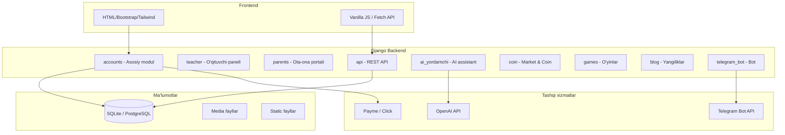

<p align="center">
  
</p>

<h1 align="center">🚀 IT Shaharcha Zomin — Learning Management System</h1>

<p align="center">
  <strong>O'zbekiston IT ta'lim markazlari uchun to'liq funksional ta'lim boshqaruv tizimi</strong>
</p>

<p align="center">
  <a href="https://www.python.org/downloads/"></a>
  <a href="https://www.djangoproject.com/"></a>
  <a href="https://www.django-rest-framework.org/"></a>
  <a href="https://openai.com/"></a>
  <a href="https://core.telegram.org/bots/api"></a>
  <a href="https://opensource.org/licenses/MIT"></a>
</p>

<p align="center">
  <a href="https://itc-academy.uz">🌐 Sayt</a> •
  <a href="#-oʻrnatish">⚙️ O'rnatish</a> •
  <a href="#-api-hujjatlari">📡 API</a> •
  <a href="#-xavfsizlik">🔐 Xavfsizlik</a> •
  <a href="#-deploy-qilish">🚀 Deploy</a>
</p>

---

## 📋 Mundarija

- [Loyiha haqida](#-loyiha-haqida)
- [Texnologiyalar](#-texnologiyalar)
- [Arxitektura](#-arxitektura)
- [Foydalanuvchi rollari](#-foydalanuvchi-rollari)
- [Ilovalar (Apps)](#-ilovalar-apps)
- [O'rnatish](#-oʻrnatish)
- [Muhit o'zgaruvchilari](#-muhit-oʻzgaruvchilari)
- [API hujjatlari](#-api-hujjatlari)
- [Xavfsizlik](#-xavfsizlik)
- [Telegram bot](#-telegram-bot)
- [Deploy qilish](#-deploy-qilish)
- [Loyiha tuzilishi](#-loyiha-tuzilishi)
- [Muallif](#-muallif)

---

## 📖 Loyiha haqida

**IT Shaharcha Zomin LMS** — bu IT ta'lim markazlari uchun yaratilgan to'liq funksional ta'lim boshqaruv tizimi. Tizim o'quvchilar, o'qituvchilar, adminlar va ota-onalar uchun alohida dashboardlar bilan ta'minlangan.

### ✨ Asosiy imkoniyatlar

| Yo'nalish | Imkoniyatlar |
|-----------|-------------|
| 📚 **Ta'lim** | Kurslar, bo'limlar, darslar (video, uyga vazifa, test, lug'at, speaking) |
| 🤖 **Sun'iy intellekt** | OpenAI asosidagi AI yordamchi, uy vazifalarini AI bilan tekshirish |
| 🪙 **Coin iqtisodiyoti** | Coin qo'lga kiritish, do'kon, P2P transfer, faollik mukofotlari |
| 🎮 **O'yinlar** | Typing challenge, so'z o'yini, shaxmat/shashka, musobaqalar |
| 📝 **Blog** | Yangiliklar, maqolalar, likes & comments |
| 🤖 **Telegram bot** | OTP login, bildirishnomalar, AI chat, ommaviy xabarlar |
| 👨‍👩‍👧 **Ota-ona portali** | Farzand progressini kuzatish, to'lovlar, o'qituvchi bilan aloqa |
| 💳 **To'lov tizimi** | Payme & Click integratsiya, balans, avtomatik chegirmalar |
| 📊 **Sertifikatlar** | Avtomatik PDF sertifikat generatsiya, CERT-ID bilan tekshirish |
| 💬 **Chat tizimi** | Guruh chat, shaxsiy xabarlar, reaktsiyalar, reply, pin |
| 📋 **So'rovnomalar** | Dinamik so'rovnoma yaratish (8 xil savol turi) |
| 📖 **Kutubxona** | Kitob ijarasi, eslatmalar, qaytarish kuzatuvi |
| 🏆 **Gamifikatsiya** | XP/level tizimi, streak, yutuqlar, reyting |

---

## 🛠 Texnologiyalar

### Backend

| Texnologiya | Versiya | Vazifasi |
|-------------|---------|----------|
| Python | 3.10+ | Asosiy til |
| Django | 5.1 | Web framework |
| Django REST Framework | 3.15.2 | REST API |
| Django Jazzmin | 3.0.2 | Admin panel UI (Cyborg tema) |
| WhiteNoise | 6.11.0 | Statik fayllar |
| Pillow | 12.1.1 | Rasm ishlov berish |
| ReportLab | 4.4.10 | PDF sertifikat generatsiya |
| OpenAI SDK | 2.21.0 | AI yordamchi |
| openpyxl | 3.1.5 | Excel eksport |
| psycopg2-binary | — | PostgreSQL driver |
| argon2-cffi | 23.1+ | Kuchli parol hashlash |
| python-dotenv | 1.0.1 | Muhit o'zgaruvchilari |
| requests | 2.32.5 | HTTP so'rovlar (Telegram API) |

### Frontend

| Texnologiya | Vazifasi |
|-------------|----------|
| HTML5 + Bootstrap 5 | Asosiy UI |
| Tailwind CSS (CDN) | Landing sahifalar |
| Vanilla JS + Fetch API | Dinamik funksionallik |
| Quill.js | Rich text editor |

### Ma'lumotlar bazasi

| Muhit | Texnologiya |
|-------|------------|
| Development | SQLite |
| Production | PostgreSQL |

---

## 🏗 Arxitektura



---

## 👥 Foydalanuvchi rollari

### 🔴 Admin
- To'liq tizim boshqaruvi
- O'quvchi/o'qituvchi qo'shish va boshqarish
- Kurslar, darslar, testlar yaratish
- To'lovlarni boshqarish va monitoring
- Tizim statistikasi va hisobotlar (PDF/Excel)
- Ommaviy xabar yuborish (Telegram + tizim ichida)
- Maintenance mode boshqaruvi
- Xavfsizlik hodisalarini kuzatish

### 🟡 Yordamchi admin
- Granular permission tizimi (AssistantRole modeli)
- Admin tomonidan belgilangan vakolatlar doirasida ishlash
- Harakatlar audit log bilan kuzatiladi

### 🟢 O'qituvchi
- O'z kurslaridagi darslarni boshqarish
- Uyga vazifalarni tekshirish va baholash
- O'quvchi progressini kuzatish
- Maosh va davomat ko'rish
- Sertifikatlarni boshqarish
- O'quvchilar bilan chat

### 🔵 O'quvchi
- Kurslarga yozilish va darslarni o'rganish
- Video darslar, testlar, uyga vazifalar
- AI yordamchidan foydalanish
- Coin yig'ish va do'konda sarflash
- O'yinlar va musobaqalarda qatnashish
- Sertifikat olish
- Blog yozish va boshqalar bilan muloqot

### 🟣 Ota-ona
- Alohida portal (Django User emas, mustaqil model)
- Farzand progressini real-time kuzatish
- Test natijalari va baholash
- To'lov tarixi
- O'qituvchi bilan xabar almashish
- Kitob ijarasi ko'rish

---

## 📦 Ilovalar (Apps)

### 1. `accounts` — Asosiy modul

> Tizimning eng katta va asosiy moduli. 50+ model, 600KB+ views.

**Asosiy modellar:**

| Model | Vazifasi |
|-------|----------|
| `CustomUser` | Foydalanuvchilar (admin, teacher, student, assistant_admin) |
| `Profession` | Kurslar va kasblar (pullik/bepul, sertifikatli, AI tekshiruv) |
| `Section` | Kurs bo'limlari (tartiblanuvchi) |
| `Lesson` | Darslar (video, homework, test, dictionary, speaking) |
| `VideoLesson` | Video darslar (YouTube/Vimeo) |
| `Homework` / `HomeworkSubmission` | Uyga vazifalar va topshiriqlar |
| `Test` / `TestQuestion` / `TestResult` | Test tizimi (lesson, midterm, practice, final) |
| `Certificate` | Sertifikatlar (CERT-YYYYMMDD-XXXX format) |
| `PaymentStatus` / `PaymentRecord` | To'lov kuzatuvi |
| `StudentBalance` | Balans tizimi (auto-deduction) |
| `Message` | Tizim ichki bildirish nomalari (12 tur) |
| `UserDevice` / `UserSession` | Qurilma va sessiya boshqaruvi |
| `GroupChatMessage` / `DirectMessage` | Chat tizimi |
| `SurveyForm` / `SurveyQuestion` | So'rovnoma tizimi |
| `PaymeTransaction` / `ClickTransaction` | To'lov gateway integratsiya |
| `SecurityEvent` | Xavfsizlik hodisalari log |
| `Book` / `BookRental` | Kutubxona tizimi |
| `Parent` / `ParentMessage` | Ota-ona modeli va xabarlar |
| `AssistantRole` / `AssistantActionLog` | Yordamchi admin roli va audit |

---

### 2. `teacher` — O'qituvchi paneli

| Model | Vazifasi |
|-------|----------|
| `TeacherCertificate` | O'qituvchi sertifikatlari |
| `TeacherSalary` | Maosh (oylik, KPI, bonus, jarima, bayram) |
| `TeacherAttendance` | Davomat (keldi, kelmadi, kech qoldi, kasal, ta'til) |

---

### 3. `parents` — Ota-ona portali

Alohida login tizimi bilan farzandlar progressini kuzatish, to'lov tarixi, o'qituvchi bilan aloqa.

---

### 4. `api` — REST API (DRF)

```
/api/v1/token/              — Autentifikatsiya token olish
/api/v1/status/             — API holati
/api/v1/profile/            — Profil ma'lumotlari
/api/v1/profile/complete/   — Profil to'ldirish
/api/v1/courses/            — Kurslar CRUD
/api/v1/students/           — O'quvchilar ro'yxati
/api/v1/coin/               — Coin operatsiyalari
/api/v1/reyting/            — Reyting/leaderboard
```

**Konfiguratsiya:** Token + Session auth, PageNumberPagination (20/sahifa), JSON renderer, coin_transfer throttle (10/min).

---

### 5. `ai_yordamchi` — AI yordamchi

| Model | Vazifasi |
|-------|----------|
| `ChatSession` | Foydalanuvchi AI chat sessiyalari |
| `ChatMessage` | Xabarlar (user/assistant), rasm va fayl qo'llab-quvvatlash |

OpenAI GPT asosida kurs mavzulari bo'yicha savol-javob. Har bir so'rov uchun coin sarflanadi.

---

### 6. `coin` — Coin iqtisodiyoti va do'kon

| Model | Vazifasi |
|-------|----------|
| `Product` | Do'kon mahsulotlari (nom, narx, zaxira) |
| `ProductLike` / `ProductComment` | Like va izohlar |
| `ProductPurchase` | Xarid tarixi (pending/delivered/cancelled) |
| `CoinTransaction` | Tranzaksiya logi (add/remove/purchase) |
| `CoinTransfer` | P2P transfer (10% komissiya, tasdiqlash kodi) |
| `ActivityLog` | Faollik kuzatuvi (17 xil harakat turi) |

---

### 7. `games` — O'yinlar va musobaqalar

| Model | Vazifasi |
|-------|----------|
| `Game` | O'yin turlari (typing, quiz, word_builder, external) |
| `Prompt` | Typing challenge matnlari (qiyinlik darajali) |
| `Competition` | Musobaqalar (coin mukofotlar: 1/2/3 o'rin) |
| `GameAttempt` | Typing natijalar (WPM, aniqlik, ball) |
| `BoardMatch` | Multiplayer o'yinlar (shaxmat/shashka, coin tikish) |
| `WordRound` / `WordGameAttempt` | So'z o'yini |
| `GameProgress` / `UserAchievement` | XP/level/yutuqlar tizimi |

> 🔒 **Xavfsizlik:** HMAC asosida natijalar tekshiruvi (cheat prevention).

---

### 8. `blog` — Yangiliklar va maqolalar

| Model | Vazifasi |
|-------|----------|
| `Post` | Maqolalar (news, tutorial, tips, announcement) |
| `PostLike` / `PostComment` | Like va izohlar (coin mukofotli) |
| `CommentLike` | Izoh likelari |

---

### 9. `telegram_bot` — Telegram bot

| Model | Vazifasi |
|-------|----------|
| `TelegramLoginCode` | OTP login kodlari (6 raqamli, 5 daqiqa) |
| `TelegramLinkToken` | Akkaunt bog'lash tokenlari |
| `TelegramMessageLog` | Kiruvchi xabarlar logi |
| `ContactMessage` | Saytdan aloqa xabarlari |
| `TelegramBroadcastMessage` | Ommaviy xabar yuborish |
| `TelegramChatState` | Foydalanuvchi holati (AI chat, contact mode) |

---

## ⚙️ O'rnatish

### Talablar

- Python 3.10+
- pip
- Git
- SQLite (development) yoki PostgreSQL (production)

### 1. Repozitoriyani klonlash

```bash
git clone https://github.com/Xusanbek0039/learning-managment-sistem-django.git
cd learning-managment-sistem-django
```

### 2. Virtual muhit yaratish

```bash
python -m venv venv

# Windows
venv\Scripts\activate

# Linux / macOS
source venv/bin/activate
```

### 3. Kutubxonalarni o'rnatish

```bash
pip install -r requirements.txt
```

### 4. Muhit o'zgaruvchilarini sozlash

`.env` faylini yarating:

```bash
cp .env.example .env
```

`.env` faylini to'ldiring (pastdagi [Muhit o'zgaruvchilari](#-muhit-oʻzgaruvchilari) bo'limiga qarang).

### 5. Ma'lumotlar bazasini migratsiya qilish

```bash
python manage.py makemigrations
python manage.py migrate
```

### 6. Superuser yaratish

```bash
python manage.py createsuperuser
```

### 7. Statik fayllarni yig'ish

```bash
python manage.py collectstatic --noinput
```

### 8. Serverni ishga tushirish

```bash
python manage.py runserver
```

Brauzerda oching: [http://127.0.0.1:8000](http://127.0.0.1:8000)

Admin panel: [http://127.0.0.1:8000/admin/](http://127.0.0.1:8000/admin/)

---

## 🔑 Muhit o'zgaruvchilari

`.env` faylida quyidagi o'zgaruvchilarni sozlang:

```env
# ═══════════════════════════════════════
# 🔐 ASOSIY SOZLAMALAR
# ═══════════════════════════════════════
DJANGO_SECRET_KEY=your-super-secret-key-here
SECRET_KEY=your-super-secret-key-here
DEBUG=True
ALLOWED_HOSTS=localhost,127.0.0.1
CSRF_TRUSTED_ORIGINS=http://localhost:8000

# ═══════════════════════════════════════
# 🗄 MA'LUMOTLAR BAZASI (Production)
# ═══════════════════════════════════════
DB_ENGINE=django.db.backends.postgresql
DB_NAME=lms_database
DB_USER=db_user
DB_PASSWORD=db_password
DB_HOST=localhost
DB_PORT=5432

# ═══════════════════════════════════════
# 🤖 OPENAI (AI yordamchi uchun)
# ═══════════════════════════════════════
OPENAI_API_KEY=sk-proj-your-openai-api-key

# ═══════════════════════════════════════
# 📱 TELEGRAM BOT
# ═══════════════════════════════════════
TELEGRAM_BOT_TOKEN=your-bot-token
TELEGRAM_BOT_USERNAME=your_bot_username
TELEGRAM_GROUP_CHAT_ID=-100xxxxxxxxxx
TELEGRAM_USE_PREMIUM_EMOJI=true
TELEGRAM_USE_STICKERS=true
SITE_URL=https://your-domain.uz

# ═══════════════════════════════════════
# 🛡 XAVFSIZLIK
# ═══════════════════════════════════════
LOGIN_MAX_ATTEMPTS=5
LOGIN_LOCKOUT_DURATION=15
GAME_HMAC_SECRET=your-hmac-secret

# ═══════════════════════════════════════
# 🔑 RECAPTCHA
# ═══════════════════════════════════════
RECAPTCHA_SITE_KEY=your-recaptcha-site-key
RECAPTCHA_SECRET_KEY=your-recaptcha-secret-key
```

---

## 📡 API hujjatlari

### Autentifikatsiya

API **Token** va **Session** autentifikatsiyasini qo'llab-quvvatlaydi.

**Token olish:**
```http
POST /api/v1/token/
Content-Type: application/json

{
    "username": "student_user",
    "password": "your_password"
}
```

**Javob:**
```json
{
    "token": "abc123def456..."
}
```

**Tokenni ishlatish:**
```http
GET /api/v1/profile/
Authorization: Token abc123def456...
```

### Asosiy endpointlar

| Metod | Endpoint | Tavsif |
|-------|----------|--------|
| `POST` | `/api/v1/token/` | Auth token olish |
| `GET` | `/api/v1/status/` | API holati |
| `GET` | `/api/v1/profile/` | Profil ma'lumotlari |
| `PUT` | `/api/v1/profile/complete/` | Profil to'ldirish |
| `GET` | `/api/v1/courses/` | Kurslar ro'yxati |
| `GET` | `/api/v1/students/` | O'quvchilar (admin) |
| `GET/POST` | `/api/v1/coin/` | Coin operatsiyalari |
| `GET` | `/api/v1/reyting/` | Reyting jadvali |

### O'yin API (tashqi o'yinlar uchun)

| Metod | Endpoint | Tavsif |
|-------|----------|--------|
| `POST` | `/api/v1/external-game/sso-verify/` | SSO tekshirish |
| `POST` | `/api/v1/external-game/result/` | Natija yuborish |
| `POST` | `/api/v1/external-game/multiplayer/find/` | Raqib topish |
| `GET` | `/api/v1/external-game/multiplayer/state/` | O'yin holati |
| `POST` | `/api/v1/external-game/multiplayer/move/` | Yurish |
| `GET` | `/api/v1/external-game/gamification/profile/` | O'yinchi profili |
| `GET` | `/api/v1/external-game/gamification/leaderboard/` | Liderlar jadvali |

### Paginatsiya

Barcha ro'yxat endpointlari `PageNumberPagination` ishlatadi (har sahifada 20 ta element):

```json
{
    "count": 150,
    "next": "http://example.com/api/v1/courses/?page=2",
    "previous": null,
    "results": [...]
}
```

### Rate Limiting

| Endpoint | Limit |
|----------|-------|
| Coin transfer | 10 so'rov/daqiqa |

---

## 🔐 Xavfsizlik

### Middleware zanjiri (tartib bo'yicha)

```
1.  SecurityMiddleware              — Django o'rnatilgan xavfsizlik
2.  RequestSizeLimitMiddleware      — >20MB so'rovlarni bloklash
3.  GlobalRateLimitMiddleware       — DDoS / brute-force himoya
4.  WhiteNoiseMiddleware            — Statik fayllar
5.  SessionMiddleware               — Session boshqaruvi
6.  CommonMiddleware                — URL normalizatsiya
7.  CsrfViewMiddleware              — CSRF himoya
8.  AuthenticationMiddleware        — Autentifikatsiya
9.  MessageMiddleware               — Flash xabarlar
10. XFrameOptionsMiddleware         — Clickjacking himoya
11. SecurityHeadersMiddleware       — CSP, HSTS headerlari
12. MaintenanceMiddleware           — Texnik xizmat rejimi
13. BlockedUserMiddleware           — Bloklangan foydalanuvchilar
14. SessionTimeoutMiddleware        — 2 soatlik session timeout
15. DeviceLimitMiddleware           — Qurilma soni cheklovi
16. ProfileCompletionMiddleware     — Profil to'ldirish majburiyati
17. SectionBlockMiddleware          — Bo'limlar blokirovkasi
18. UpdateLastActivityMiddleware    — Faollik kuzatuvi
19. PaymentCheckMiddleware          — To'lov tekshiruvi
20. BirthdayCheckMiddleware         — Tug'ilgan kun tabrik
21. PremiumExpiryMiddleware         — Premium muddati tekshiruvi
```

### Xavfsizlik choralari

| Himoya | Tavsif |
|--------|--------|
| **Parol hashlash** | PBKDF2 (default) + Argon2 (agar o'rnatilgan bo'lsa) |
| **HTTPS** | HSTS 1 yil (production), SSL redirect, secure cookies |
| **CSP** | Content Security Policy — XSS hujumlardan himoya |
| **CSRF** | SameSite=Lax, HttpOnly cookies |
| **Session** | DB-backed, custom cookie (`itc_sid`), 2 soat muddatli |
| **Login himoya** | 5 ta urinish, 15 daqiqa blokirovka |
| **Fayl yuklash** | Max 10MB (fayl), Max 20MB (umumiy) |
| **O'yin xavfsizligi** | HMAC-based natija tekshiruvi |
| **Logging** | Rotating file handler (5MB × 10 fayl) |
| **Qurilma boshqaruvi** | Qurilma limiti, ishonchli qurilma tizimi |

### Xavfsizlik hodisalari

Tizim 17 xil xavfsizlik hodisasini 4 darajada (info, warning, error, critical) kuzatadi va `logs/security.log` fayliga yozadi.

---

## 🤖 Telegram bot

### Imkoniyatlari

| Funksiya | Tavsif |
|----------|--------|
| 🔑 **OTP Login** | 6 raqamli kod bilan tezkor kirish (5 daqiqa amal qiladi) |
| 🔗 **Akkaunt bog'lash** | Telegram hisobni LMS hisobiga ulash |
| 📢 **Bildirishnomalar** | Yangi dars, uyga vazifa, test natijalari haqida xabar |
| 📨 **Ommaviy xabar** | Barcha / o'quvchilar / o'qituvchilar / guruh / individual |
| 🤖 **AI chat** | Telegram orqali AI yordamchidan foydalanish |
| 📞 **Aloqa** | Sayt orqali aloqa xabarlari (loginsiz) |
| ✨ **Premium emoji** | Premium animatsiyali emoji va stikerlar |

### Bot sozlamalari

```env
TELEGRAM_BOT_TOKEN=your-bot-token
TELEGRAM_BOT_USERNAME=your_bot_username
TELEGRAM_GROUP_CHAT_ID=-100xxxxxxxxxx
SITE_URL=https://your-domain.uz
```

> ⚠️ `SITE_URL` bo'sh yoki `*` bo'lsa — bot lokal **polling** rejimida ishlaydi. Production uchun real domen kerak (**webhook** rejimi).

### Webhook sozlash

```
POST https://api.telegram.org/bot<TOKEN>/setWebhook
?url=https://your-domain.uz/telegrambotlms/webhook/
```

---

## 🚀 Deploy qilish

### Production sozlamalari

1. **`.env` faylini yangilang:**

```env
DEBUG=False
ALLOWED_HOSTS=your-domain.uz,www.your-domain.uz
CSRF_TRUSTED_ORIGINS=https://your-domain.uz,https://www.your-domain.uz
DJANGO_SECRET_KEY=juda-uzun-va-murakkab-kalit
```

2. **PostgreSQL ga o'ting:**

```env
DB_ENGINE=django.db.backends.postgresql
DB_NAME=lms_db
DB_USER=lms_user
DB_PASSWORD=strong_password
DB_HOST=localhost
DB_PORT=5432
```

3. **Statik fayllarni yig'ing:**

```bash
python manage.py collectstatic --noinput
```

4. **Migratsiyalarni bajaring:**

```bash
python manage.py migrate
```

### cPanel / Passenger deploy

Loyiha `passenger_wsgi.py` fayliga ega bo'lib, cPanel/Passenger muhitida deploy qilishga tayyor:

```python
# passenger_wsgi.py avtomatik ravishda:
# - .env faylni yuklaydi
# - WSGI ilovasini sozlaydi
# - X-Powered-By va Server headerlarini yashiradi (xavfsizlik)
```

### Muhim fayllar

| Fayl | Vazifasi |
|------|----------|
| `passenger_wsgi.py` | cPanel/Passenger WSGI konfiguratsiya |
| `.htaccess` | Apache konfiguratsiya |
| `robots.txt` | Qidiruv tizimi boshqaruvi |
| `sitemap.xml` | Sayt xaritasi |
| `requirements.txt` | Python kutubxonalar ro'yxati |

---

## 📁 Loyiha tuzilishi

```
learning-managment-sistem-django/
│
├── config/                     # Django loyiha konfiguratsiyasi
│   ├── settings.py             # Asosiy sozlamalar
│   ├── urls.py                 # URL marshrutlash
│   ├── wsgi.py                 # WSGI konfiguratsiya
│   └── asgi.py                 # ASGI konfiguratsiya
│
├── accounts/                   # 📋 Asosiy modul (foydalanuvchilar, kurslar, to'lovlar)
│   ├── models.py               # 50+ model (2500+ qator)
│   ├── views.py                # Asosiy views (600KB+)
│   ├── middleware.py           # 15+ custom middleware
│   ├── security.py             # Xavfsizlik yordamchilari
│   ├── notifications.py       # Bildirishnomalar (tizim + Telegram)
│   ├── permissions_registry.py # Ruxsat tizimi
│   ├── payment_views.py       # Payme & Click to'lov viewlari
│   ├── parent_views.py        # Ota-ona viewlari
│   ├── yordamchi_views.py     # Yordamchi admin viewlari
│   ├── forms.py                # Formalar
│   ├── admin.py                # Admin panel konfiguratsiya
│   └── urls.py                 # URL marshrutlash
│
├── teacher/                    # 👨‍🏫 O'qituvchi paneli
│   ├── models.py               # Sertifikat, maosh, davomat
│   ├── views.py                # O'qituvchi viewlari
│   └── urls.py
│
├── parents/                    # 👨‍👩‍👧 Ota-ona portali
│   ├── portal_views.py         # Portal viewlari
│   ├── portal_urls.py          # Portal URL'lari
│   └── urls.py
│
├── api/                        # 📡 REST API
│   ├── urls.py                 # API endpointlar
│   ├── views.py                # API viewlari
│   ├── assistant/              # Yordamchi admin API
│   ├── coin/                   # Coin API
│   └── reyting/                # Reyting API
│
├── ai_yordamchi/               # 🤖 AI yordamchi (OpenAI)
│   ├── models.py               # ChatSession, ChatMessage
│   ├── views.py                # AI chat viewlari
│   └── urls.py
│
├── coin/                       # 🪙 Coin iqtisodiyoti va do'kon
│   ├── models.py               # Product, Transaction, Transfer
│   ├── views.py                # Do'kon viewlari
│   └── urls.py
│
├── games/                      # 🎮 O'yinlar va musobaqalar
│   ├── models.py               # Game, Competition, BoardMatch
│   ├── views.py                # O'yin viewlari
│   └── urls.py
│
├── blog/                       # 📝 Blog va yangiliklar
│   ├── models.py               # Post, PostLike, PostComment
│   ├── views.py                # Blog viewlari
│   └── urls.py
│
├── telegram_bot/               # 📱 Telegram bot
│   ├── models.py               # LoginCode, BroadcastMessage
│   ├── utils.py                # Bot API funksiyalari
│   ├── premium.py              # Premium emoji/stiker
│   └── urls.py
│
├── templates/                  # 🎨 Shablonlar
│   ├── landing.html            # Landing sahifa
│   ├── 403.html / 404.html / 500.html  # Xato sahifalar
│   └── 403_csrf.html
│
├── static/                     # 📦 Statik fayllar (CSS, JS, images)
├── staticfiles/                # 📦 collectstatic natijalari
├── media/                      # 📁 Foydalanuvchi yuklagan fayllar
├── logs/                       # 📋 Log fayllar
│
├── manage.py                   # Django boshqaruv skripti
├── requirements.txt            # Python kutubxonalar
├── passenger_wsgi.py           # cPanel deploy
├── .env                        # Muhit o'zgaruvchilari
├── .htaccess                   # Apache konfiguratsiya
├── robots.txt                  # SEO - qidiruv botlari
└── sitemap.xml                 # SEO - sayt xaritasi
```

---

## 📊 URL marshrut xaritasi

| Prefiks | Ilova | Tavsif |
|---------|-------|--------|
| `/` | `accounts` | Asosiy sahifalar (login, dashboard, kurslar) |
| `/` | `coin` | Do'kon va coin operatsiyalari |
| `/admin/` | Django Admin | Jazzmin admin paneli |
| `/api/v1/` | `api` | REST API endpointlar |
| `/ai/` | `ai_yordamchi` | AI yordamchi |
| `/teacher/` | `teacher` | O'qituvchi paneli |
| `/yordamchi/` | `accounts` | Yordamchi admin sahifalari |
| `/dashboard/parents/` | `parents` | Ota-onalar (admin ko'rinishi) |
| `/parent/` | `parents` | Ota-ona portali |
| `/blog/` | `blog` | Blog va yangiliklar |
| `/games/` | `games` | O'yinlar |
| `/telegrambotlms/` | `telegram_bot` | Telegram webhook |

---

## 🧪 Testlash

```bash
# Barcha testlarni ishga tushirish
python manage.py test

# Alohida app testlari
python manage.py test accounts
python manage.py test games

# Xavfsizlik testlari
python test_security.py
```

---

## 📈 Kelajakdagi rejalar

- [ ] WebSocket orqali real-time chat (Django Channels)
- [ ] Mobil ilova (Flutter / React Native)
- [ ] Video darslarni to'g'ridan-to'g'ri yuklash (AWS S3)
- [ ] Ko'p tilli qo'llab-quvvatlash (i18n)
- [ ] Redis cache integratsiya
- [ ] Celery — fon vazifalari uchun
- [ ] Docker konteynerizatsiya

---

## 🤝 Hissa qo'shish

1. Repozitoriyani fork qiling
2. Yangi branch yarating (`git checkout -b feature/yangi-funksiya`)
3. O'zgarishlarni commit qiling (`git commit -m 'feat: yangi funksiya qo'shildi'`)
4. Branch'ni push qiling (`git push origin feature/yangi-funksiya`)
5. Pull Request oching

---

## 📄 Litsenziya

Bu loyiha [MIT](https://opensource.org/licenses/MIT) litsenziyasi ostida tarqatiladi.

---

## 👨‍💻 Muallif

<p align="center">
  <strong>Husanbek Suyunov</strong><br/>
  <em>Full-Stack Developer | IT Shaharcha Zomin asoschisi</em>
</p>

<p align="center">
  <a href="https://github.com/Xusanbek0039"></a>
  <a href="https://itc-academy.uz"></a>
</p>

---

<p align="center">
  <sub>© 2024-2026 Suyunov Husan | IT Shaharcha Zomin. Barcha huquqlar himoyalangan.</sub>
</p>

Claude edit test
